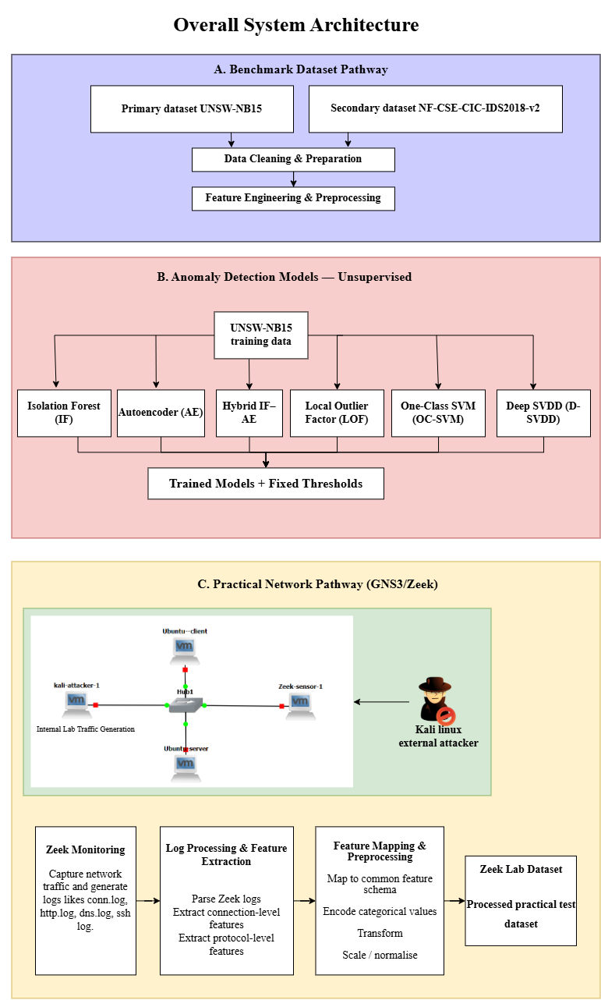
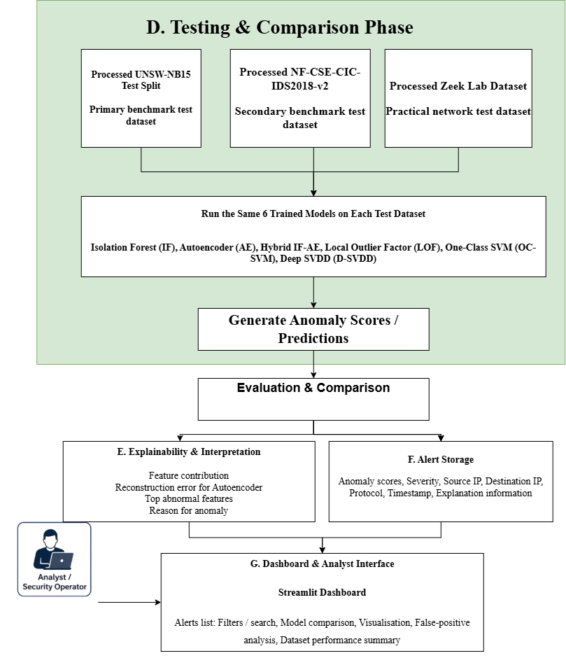

# Explainable and False-Positive-Aware Hybrid Unsupervised Network Anomaly Detection

**Australian SME Financial Services | COIT20265 – Networks and Information Security Project | Group PG3 | HT2 2026**  
**CQUniversity Australia**

## Project overview

This research prototype investigates whether **normal-only anomaly detectors trained on UNSW-NB15** can identify unusual network traffic in other environments without producing an unacceptable number of false alarms.

We developed and evaluated **six detectors**: Isolation Forest (IF), Dense Autoencoder (AE), a score-level **Hybrid IF + AE**, Local Outlier Factor (LOF), One-Class SVM (OCSVM), and Deep SVDD. The evaluation uses three traffic environments:

1. **UNSW-NB15:** source-domain training, validation and held-out testing.
2. **NF-CSE-CIC-IDS2018-v2:** independent benchmark for cross-domain testing.
3. **GNS3/VMware/Zeek:** controlled practical network for generating, capturing and evaluating normal and attack traffic.

The main research question is not simply *which model obtains the highest accuracy?* It is **whether a model and its original decision threshold remain useful when normal network behaviour changes**. The implementation includes portable feature engineering, a fixed 41-column model interface, frozen-model transfer tests, normal-only threshold recalibration, threshold-sensitivity analysis, and an analyst-facing Streamlit dashboard.

## End-to-end architecture

The following diagram illustrates the overall architecture of our network anomaly detection system, including dataset preparation, feature engineering, six anomaly detection models, threshold calibration, evaluation, and the Streamlit dashboard.

*Figure 1: Overall system architecture of the proposed network anomaly detection prototype.*

**Important design rule:** Labels indicating normal/attack are retained for **evaluation**. Attack labels are not used to train the one-class detectors or to select normal-only recalibration thresholds. The Hybrid is an equal-weight combination of two trained detectors, not a separately trained sixth neural/network model.

## Why three datasets?

The datasets have **different experimental roles**, rather than being combined into one training set:

| Dataset | Purpose | Prepared evaluation data |
|---|---|---|
| **UNSW-NB15** | Fit the preprocessing pipeline, train normal-only models, select initial thresholds, and test in-domain | 41,065 normal training records; 10,266 normal validation records; 82,332 official test records |
| **NF-CSE-CIC-IDS2018-v2** | Test transfer to a distinct benchmark flow distribution | 700,000 sampled records: 400,000 normal and 300,000 attack, from an 18,893,708-flow source |
| **GNS3/Zeek (v5)** | Test on independently generated, labelled practical network traffic | 6,966 records: 2,753 normal and 4,213 attack/anomaly |

NF-CSE was processed in **200,000-row chunks**. Its 700,000-row evaluation sample was deliberately constructed, so its attack prevalence does not represent real-world network prevalence. Likewise, the GNS3 sample is attack-heavy and represents a controlled experiment, not ordinary SME traffic.

## Feature preparation: 21 portable fields to 41 model inputs

The source preprocessing contract starts with **21 portable network fields**: **18 numerical fields** and **three categorical fields** (protocol, service and connection state). Numeric processing and encoding of categorical values produce a **fixed set of 41 ordered numerical model features**.

- The source-domain preprocessor is fitted on UNSW training data and **saved**.
- The same fitted transformer and feature order are used for UNSW, NF-CSE and GNS3/Zeek evaluation.
- Fields such as `sttl` were omitted because they risk carrying benchmark-specific fingerprints rather than portable network behaviour.
- The transformed matrices were checked for expected dimensions and invalid numerical values.

**Compatibility caveat:** Matching 41 column names and dimensions is necessary but does not prove that every field has identical meaning across different capture tools and datasets. Some protocol, state and connection-context mappings remain approximate.

## Implemented models

| Model | Detection approach | Key implementation detail |
|---|---|---|
| **Isolation Forest** | Tree-based isolation of unusual observations | 300 estimators; `max_samples=0.8`; seed 42 |
| **Dense Autoencoder** | Reconstruction error for deviations from learned normal traffic | 41–32–16–8–16–32–41 network; Adam and MSE loss |
| **Hybrid IF + AE** | Score-level combination of complementary detectors | Validation-percentile normalisation; fixed 50% IF / 50% AE weighting |
| **Local Outlier Factor** | Local-neighbourhood density deviation | `n_neighbors=20`; novelty mode for unseen records |
| **One-Class SVM** | Nonlinear boundary around normal traffic | RBF kernel; `nu=0.01`; `gamma=scale` |
| **Deep SVDD** | Distance from a learned normal representation centre | 41–64–32–16 network; 30 training epochs |

All model outputs use a common interpretation: **a higher score means a more anomalous record**. The reported configurations are the implemented settings, not claims of globally optimal hyperparameters.

## Practical GNS3 / VMware / Zeek laboratory

We built a virtual network using GNS3 and VMware, including an Ubuntu client, Ubuntu server, Kali Linux attacker and Zeek monitoring sensor. We generated normal and attack traffic, captured network activity using Zeek, and processed the collected logs into a practical dataset to evaluate our six machine learning models.

The practical data pipeline preserves scenario/source information alongside the evaluation labels. The final v5 records were transformed into a **6,966 × 41** model-input matrix. This setup demonstrates collection and offline testing.

## Evaluation design: three stages

### Stage 1 — Frozen source-threshold transfer

Apply the **original UNSW normal-validation thresholds**, without changing models or thresholds, to the source and external test datasets. This tests whether the source operating point transfers to a new traffic distribution.

### Stage 2 — Target-normal recalibration

Keep model parameters and the 41-column preprocessing contract **frozen**, but select a new threshold from **normal target-domain calibration records**. At a nominal 1% alert budget, the threshold is approximately the **99th percentile of normal calibration scores**. Target attack labels are not used to choose it.

- **NF-CSE:** 100,000 normal records reserved for calibration; **600,000** held out for testing (300,000 normal and 300,000 attack).
- **GNS3/Zeek:** 1,945 normal records reserved for calibration; **5,021** held out for testing (808 normal and 4,213 attack).

### Stage 3 — Threshold-sensitivity analysis

With models and held-out test records unchanged, compare **0.5%, 1%, 2%, 3%, 5% and 10%** normal-tail calibration budgets. A larger nominal budget usually permits more alerts, but does not necessarily produce enough additional attack detection to justify them.

**Terminology:** A *1% calibration budget* is a threshold chosen using normal calibration data. It is **not a guarantee** of 1% false positives on unseen test records.

## Selected results

### Stage 1: original UNSW thresholds

| Test environment | Measured false-positive behaviour at the 1% source setting | Interpretation |
|---|---|---|
| UNSW-NB15 held-out | **4.35%–5.70% FPR** across the six models | Even the source held-out partition differed from the calibration normal records |
| NF-CSE external | **93.30%–100% FPR** | Original source thresholds failed badly in the new benchmark domain |
| GNS3/Zeek practical | **Approximately 99% FPR** for all six models | Almost every practical normal flow was incorrectly flagged |

These high recall values can be misleading when a model flags nearly everything as anomalous. A useful detector must be judged by both its attack detection and its **false-alert workload**.

### Stage 2: selected results at the 1% target-normal budget

| Test dataset | Detector | Attack recall | Measured FPR | Interpretation |
|---|---|---:|---:|---|
| NF-CSE (600,000 held out) | **One-Class SVM** | **81.9%** | **1.03%** | Useful score separation with a recalibrated cutoff; F1 approximately **0.896** |
| GNS3/Zeek (5,021 held out) | **Isolation Forest** | **59.22%** | **7.92%** | Better attack coverage, but notable false-alert burden |
| GNS3/Zeek (5,021 held out) | **Deep SVDD** | **24.35%** | **1.73%** | Fewer false alerts, but many attacks missed |
| GNS3/Zeek (5,021 held out) | **Hybrid IF + AE** | **63.47%** | **50.37%** | High false-alert rate remains unacceptable despite its recall |

### Stage 3: sensitivity highlights

- **NF-CSE One-Class SVM, 0.5% budget:** approximately **81.8% recall** and **0.50% measured FPR**.
- **GNS3/Zeek Deep SVDD, 3% budget:** **64.68% recall** and **4.46% measured FPR**.
- **GNS3/Zeek Hybrid:** recall remained around **63.47%** and FPR around **50.37%** across all six budgets, indicating limited threshold control from tied/saturated scores.

**Comparison limitation:** Stage 1 and Stage 2 results use **different held-out populations** because Stage 2 reserves normal records for calibration. Therefore, the numerical change between those published rows **cannot be attributed solely to recalibration**. A strictly paired estimate would evaluate both threshold choices on the same held-out records.

## Streamlit dashboard and analyst evidence

The dashboard is built around **saved offline model and evaluation exports**, not a continuous Zeek live feed. Implemented interfaces include:

- Model-specific views and a six-model comparison page.
- Dataset-specific test views for **UNSW-NB15, NF-CSE and GNS3/Zeek**.
- Anomaly scores, threshold decisions, precision/recall/F1/FPR and comparison charts.
- Record, scenario and evidence inspection where the corresponding exports exist.
- An **SQLite-backed Hybrid alert view** with **82,332 UNSW records**, including agreement information from the IF and AE components.
- Analyst-oriented explanations of score direction, threshold crossings and review priority/severity.

These explanations describe the available **decision evidence**. They should **not** be described as verified SHAP feature attribution, causal explanations, or proof that an alert represents a real attack. The interface supports **human review** and does not perform automatic blocking.

## Key research findings and limitations

1. **Threshold transfer is fragile.** The original UNSW cutoffs generated excessive false alerts in both target environments.
2. **Recalibration cannot rescue poor ranking.** Moving a threshold can improve an operating point only when model scores provide useful separation between normal and attack traffic.
3. **No universal detector or budget emerged.** One-Class SVM performed strongly on NF-CSE after recalibration, while the practical GNS3 environment showed different trade-offs.
4. **The current Hybrid has saturation/ties.** Percentile-normalised score concentration made some threshold settings ineffective.
5. **Portability is incomplete.** The 41-column contract is structurally consistent, but approximate cross-source feature mapping and traffic distribution shift remain threats to validity.
6. **Results are experimental.** The GNS3 traffic is controlled and attack-heavy, some attack scenarios contain very few records, and the prototype has not been validated for continuous business operation.

## Project team

| Team member | Main contribution |
|---|---|
| **Labannya Barua** | UNSW-NB15 source preparation; benchmark three-stage testing and threshold analysis |
| **Syed Rubaiyat Karim** | NF-CSE compatibility engineering; Isolation Forest, Autoencoder and Hybrid implementation |
| **Arjita Saha** | GNS3/VMware/Zeek lab; practical traffic and dataset engineering; three-stage GNS3 evaluation |
| **Mst Sinha Naznin** | LOF, One-Class SVM and Deep SVDD; Streamlit dashboards, integration and SQLite alert view |

**Research takeaway:** Strong performance on one benchmark does not guarantee a manageable false-positive rate on another network. The threshold is an **environment-dependent decision parameter**, and its measured performance must be validated separately from the model training process.
